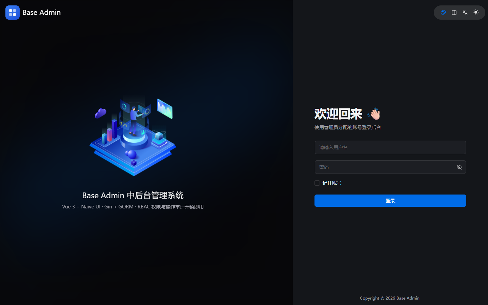
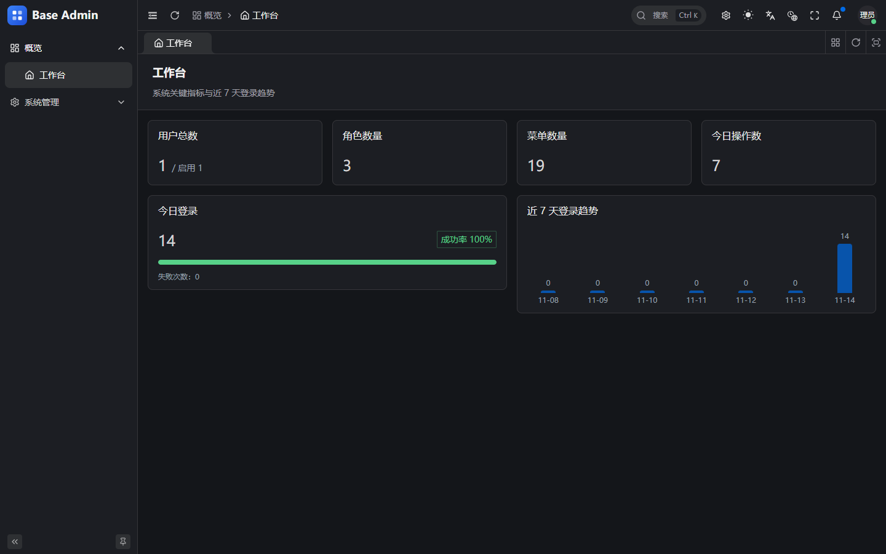
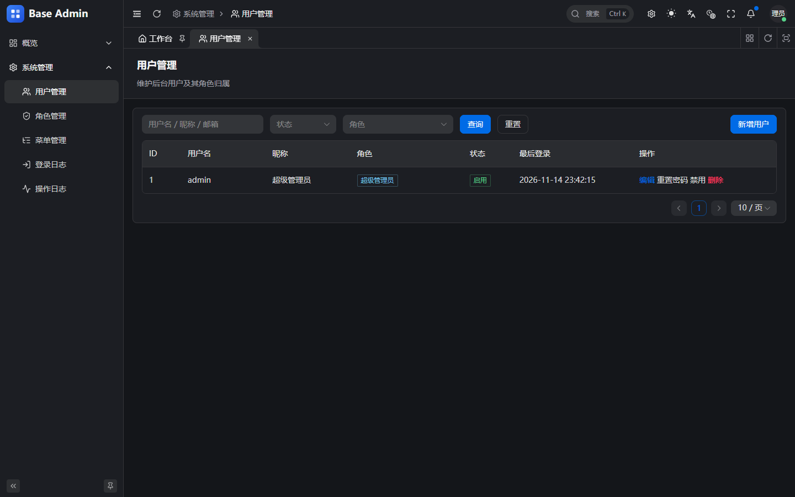
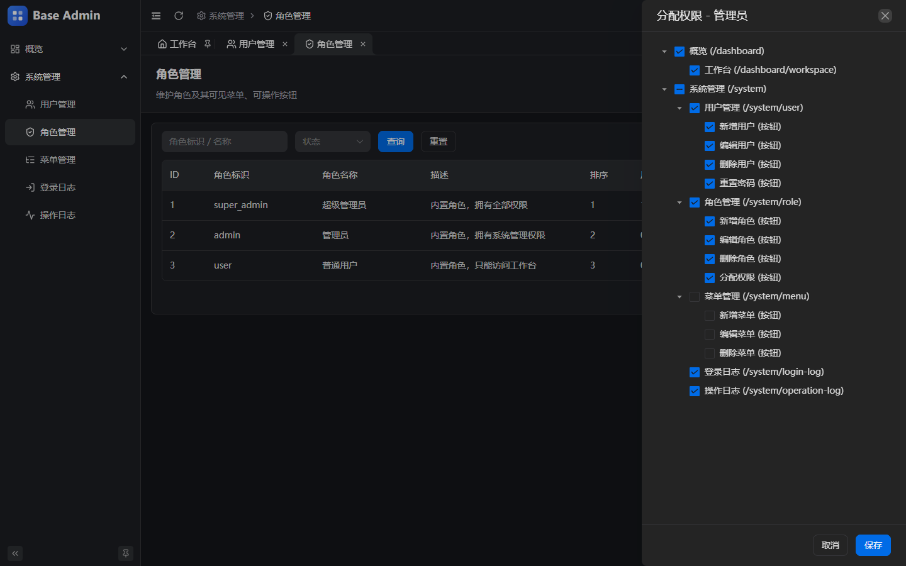
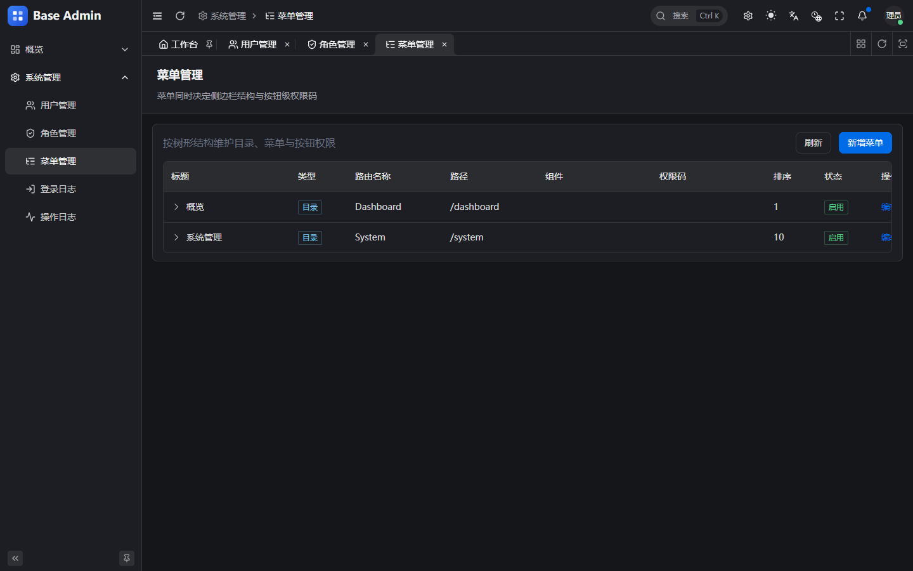
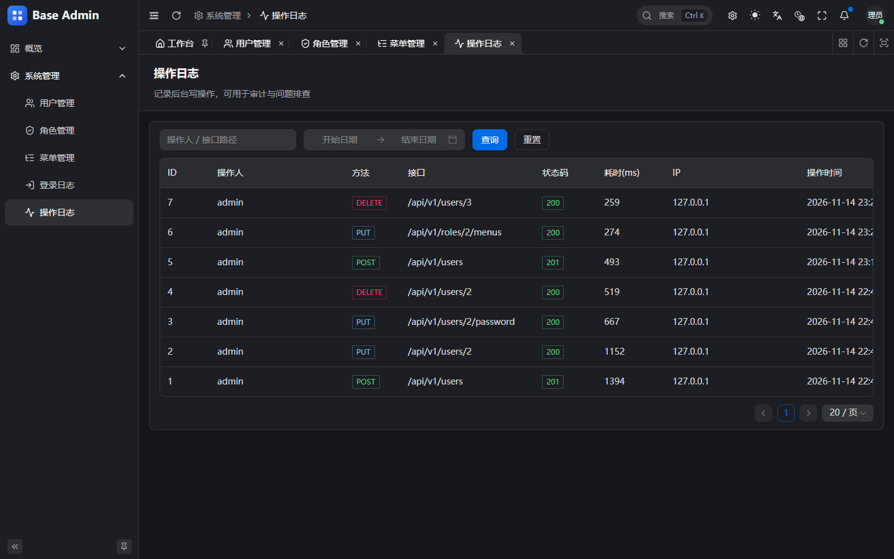

# base-admin-core

基于 **Vben Admin 5 (Vue 3 + Naive UI)** 与 **Gin + GORM** 的后台管理模板。

- 前端：[vue-vben-admin](https://github.com/vbenjs/vue-vben-admin) v5.7.0（`apps/web-naive` 精简为单应用 `frontend/apps/web`），UI 组件库为 Naive UI。
- 后端：Gin + GORM，PostgreSQL 18，Redis 7，JWT（access + refresh）+ Redis 会话，RBAC 权限，审计日志。
- 数据表统一前缀，默认 `base_`，通过环境变量 `DB_TABLE_PREFIX` 配置，可与其他系统共用一个数据库。
- 所有服务配置均从环境变量读取（`backend/.env`），代码中不保留任何硬编码连接串与密钥。

## 界面预览

| 登录 | 工作台 |
| --- | --- |
|  |  |

| 用户管理 | 角色权限分配 |
| --- | --- |
|  |  |

| 菜单管理 | 操作日志 |
| --- | --- |
|  |  |

## 目录结构

```
base-admin-core/
├── backend/                     Go 服务
│   ├── cmd/
│   │   ├── server/              启动 HTTP 服务（自动执行迁移）
│   │   └── migrate/             只执行数据库迁移
│   ├── internal/                 应用私有代码（Go 编译期禁止外部 import）
│   │   ├── bootstrap/           启动时初始化超级管理员
│   │   ├── config/              环境变量配置加载与校验
│   │   ├── handler/             HTTP 处理器（参数绑定 + 调用 service）
│   │   ├── middleware/          请求 ID / 访问日志 / 恢复 / CORS / 认证 / 鉴权 / 操作日志
│   │   ├── model/               GORM 模型与常量
│   │   ├── repository/          数据访问层（仅此层出现 SQL）
│   │   ├── server/              路由注册与优雅退出
│   │   ├── service/             业务逻辑层
│   │   └── throttle/            登录失败限流（应用策略，因此不前移到 pkg）
│   ├── pkg/                     可复用基础设施（不依赖 internal，可被其他项目 import）
│   │   ├── apperr/              业务错误码与 HTTP 状态映射
│   │   ├── jwt/                 JWT 签发与校验
│   │   ├── logger/              slog 日志与 GORM 适配
│   │   ├── migrate/             SQL 迁移执行器（前缀占位符 + 校验和）
│   │   ├── password/            bcrypt 密码哈希与随机密码
│   │   ├── postgres/            PostgreSQL / GORM 连接与连接池
│   │   ├── redis/               Redis 客户端
│   │   ├── response/            统一响应封装与参数绑定
│   │   └── session/             Redis 会话存取
│   ├── migrations/              带 {{prefix}} 占位符的 SQL 迁移
│   └── .env.example             配置模板（每一项都有注释）
├── frontend/                    Vben 5 monorepo（仅保留 Naive UI 应用）
│   └── apps/web/                src/api、src/views、src/router、src/store
├── docs/                        架构、接口、部署说明
├── Makefile                     常用命令
└── .dev/env.ps1                 Windows 本地开发环境变量（把 Go/pnpm 缓存放仓库内）
```

## 快速开始

### 1. 后端

```bash
cd backend
cp .env.example .env      # 按需修改数据库、Redis、JWT 配置
go run ./cmd/migrate      # 建表 + 初始化角色/菜单（可重复执行）
go run ./cmd/server       # 默认监听 :8080
```

启动时会自动执行未应用的迁移（`DB_MIGRATE=true`），并按 `BOOTSTRAP_ADMIN_*` 创建超级管理员。
若 `BOOTSTRAP_ADMIN_PASSWORD` 留空，则生成随机密码并在首次启动日志中打印一次。

默认账号（见 `backend/.env`）：`admin` / `Admin@123456`

### 2. 前端

```bash
cd frontend
pnpm install
pnpm dev                  # http://127.0.0.1:5888，/api 代理到 http://127.0.0.1:8080
```

生产构建：`pnpm build`，产物位于 `frontend/apps/web/dist`（同时生成 `dist.zip`）。

### Windows 本地开发说明

本仓库的 Go 缓存与 pnpm store 都落在仓库内的 `.cache/`（`.gitignore` 已忽略），避免污染全局目录：

```powershell
iex (Get-Content .dev\env.ps1 -Raw)      # 设置 GOPATH/GOMODCACHE/GOCACHE/PNPM_HOME 等
```

若安装依赖时跳过了生命周期脚本（`pnpm install --ignore-scripts`），vben 的 workspace 包需要手工生成 stub，否则
`vite.config.ts` 会报 `Failed to resolve entry for package "@vben/vite-config"`：

```bash
pnpm -F @vben/vite-config run stub
pnpm -F @vben/node-utils run stub
```

> `frontend/.npmrc` 中显式设置了 `node-linker=hoisted`：vben 的 `stub`（tsdown）在部分沙箱/受限环境下无法穿透
> pnpm 的 junction 软链，改为平铺安装可避免 `Cannot find package 'ansis'` 一类的解析失败。

### 3. 常用命令

```bash
make help                 # 查看全部命令
make backend-check        # gofmt + go vet + go test
make frontend-typecheck   # vue-tsc 类型检查
make check                # 前后端一起检查
```

## 配置

后端只认环境变量（`.env` 由 `godotenv` 在本地加载），完整清单见
[`backend/.env.example`](backend/.env.example) 与 [docs/deployment.md](docs/deployment.md)。

关键项：

| 变量 | 默认值 | 说明 |
| --- | --- | --- |
| `DB_TABLE_PREFIX` | `base_` | 数据表统一前缀，可为空 |
| `DB_HOST` / `DB_PORT` / `DB_USER` / `DB_PASSWORD` / `DB_NAME` | - | PostgreSQL 连接 |
| `REDIS_ADDR` / `REDIS_USERNAME` / `REDIS_PASSWORD` / `REDIS_DB` | - | Redis 连接 |
| `REDIS_KEY_PREFIX` | `base-admin:` | Redis key 命名空间，避免与其他系统冲突 |
| `JWT_SECRET` | - | 必填，至少 32 字符（`openssl rand -base64 48`） |
| `JWT_ACCESS_TTL` / `JWT_REFRESH_TTL` | `30m` / `168h` | access / refresh 有效期 |
| `SECURITY_LOGIN_MAX_ATTEMPTS` | `5` | 登录失败次数阈值（窗口内） |
| `BOOTSTRAP_ADMIN_USERNAME` / `BOOTSTRAP_ADMIN_PASSWORD` | `admin` / 空 | 超级管理员初始化 |

## 接口约定

- 统一前缀 `/api/v1`，统一响应体 `{"code":0,"message":"ok","data":...}`，`code=0` 表示成功。
- 认证：`Authorization: Bearer <accessToken>`；access 过期用 `POST /auth/refresh` 换新（refresh token 轮换）。
- 菜单即路由：`GET /auth/menus` 返回 Vben 后端模式可直接消费的路由记录。
- 权限码：`GET /auth/codes` 返回当前用户权限码（如 `system:user:create`），前端用 `v-access:code` 控制按钮。

明细见 [docs/api.md](docs/api.md)。

## 文档

- [架构说明](docs/architecture.md)：分层、认证与权限、表前缀与迁移、审计日志。
- [接口文档](docs/api.md)：全部接口与请求/响应示例。
- [部署说明](docs/deployment.md)：构建、反向代理、systemd、环境变量清单。

## License

[MIT](LICENSE)
