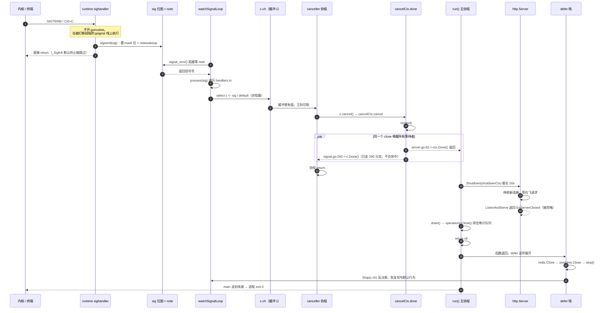
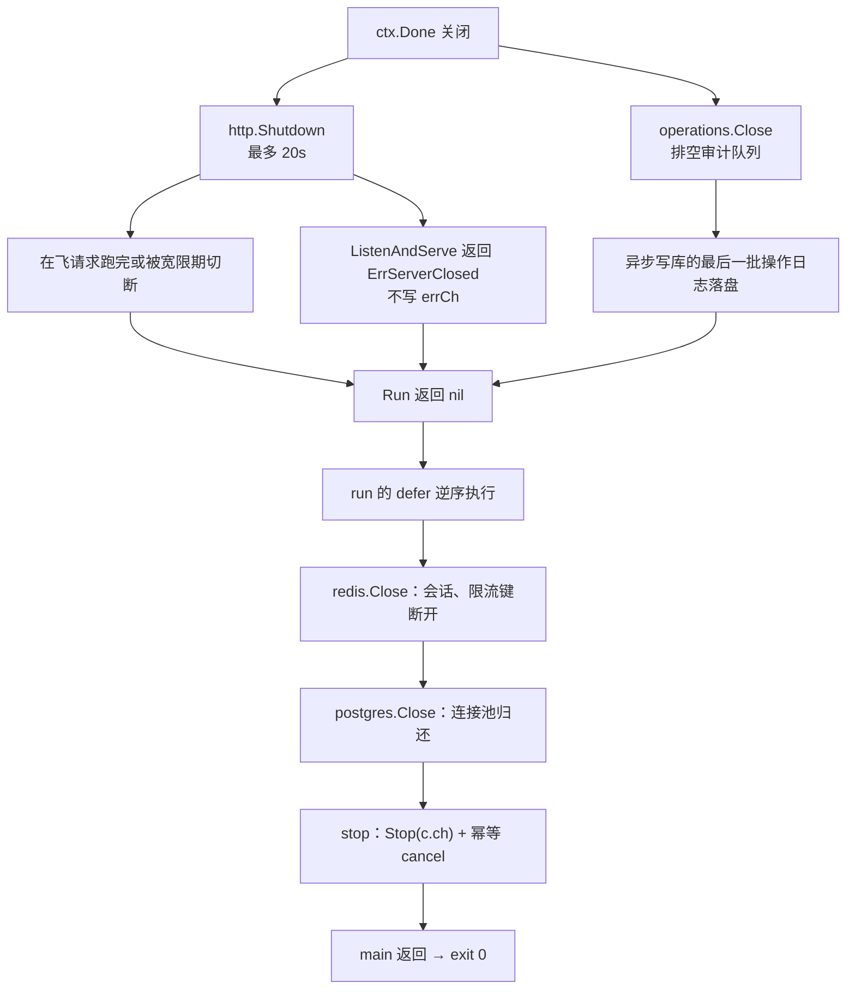

# 笔记：从信号到进程退出

- 日期：2026-11-18
- 状态：已定，且已落地（`cmd/server` + `internal/server`）
- 结论：信号只做一件事——关闭 `ctx.Done()`；进程之所以退出，是因为 `run()` 返回、`main` 走到函数末尾，而不是信号本身杀了进程。

---

## 1. 起因

`internal/server/deadline.go` 改成「只注入 deadline」之后，`server.Run(ctx)` 里剩下一个 select：

```go
select {
case err := <-errCh:   // 监听失败
	s.drain()
	return err
case <-ctx.Done():     // 取消 → 优雅关闭
}
```

问题很自然：`ctx` 是 `signal.NotifyContext` 造的，那么「按下 Ctrl+C」到「进程消失」之间，究竟发生了什么？中间隔着 runtime、`os/signal`、`context` 三层，任何一层理解错了，写出来的关闭逻辑就是错的。

---

## 2. 唯一的阻塞点

`main` 只有五行，正常路径上没有任何 `os.Exit`：

```go
func main() {
	if err := run(); err != nil {
		fmt.Fprintf(os.Stderr, "fatal: %v\n", err)
		os.Exit(1)     // 只有出错才主动退出
	}
}                      // 正常路径：函数返回 = 进程退出
```

`run()` 的最后一行是 `return server.New(...).Run(ctx)`（`cmd/server/main.go:138`），而 `Run` 里真正阻塞的就是上面那个 select（`internal/server/server.go:58-63`）。**main goroutine 停在这里**，等两件事之一：监听协程报错，或者 ctx 被取消。

Go 里「进程结束」的定义就是 main goroutine 从 `main` 函数返回，运行时随即结束进程，不等待其他 goroutine。所以要让服务退出，唯一的办法是让这个 select 返回、让整条调用链一路 return 回去。

---

## 3. 信号进入 Go 代码之前：不是 goroutine

这一点最反直觉。信号到来时，内核中断某个线程，runtime 在**该线程的 gsignal 栈**上执行 `sighandler`——它没有 goroutine 结构，因此不能用 `defer`、不能分配内存、不能调度。`sigsend` 的注释就写着 `defer is not available`。

它只做两件事：把信号号写进位图 `sig.mask`，然后 `notewakeup(&sig.note)` 唤醒等待者。

- 位图而不是队列：`mask/wanted/ignored/recv` 各是 `[_NSIG/32]uint32`，65 个信号只占几个 word。同一信号连续来两次会被合并，这正是「信号是通知、不是消息」的物理体现。
- 接收端只有一个：`signal_recv()` 用三态状态机（idle / receiving / sending）+ note 阻塞等待，注释明确要求「同一时刻只能有一个 goroutine 调用」。所以「每个信号一个接收协程」是错的。
- `sighandler` 末尾判断：如果这个信号被 `Notify` 登记过（`sig.wanted` 位为 1），`sigsend` 返回 true 就直接 `return`，**跳过 `_SigKill` 的默认终止分支**。

最后这条是关键：`Notify` 之后，该信号不再具有「杀掉进程」的默认语义，它只剩下「投递到 channel」这一个作用。进程死活从此完全由代码决定。

---

## 4. 从 channel 到 context 关闭

`signal.NotifyContext(parent, os.Interrupt, syscall.SIGTERM)` 展开后是三件事（`os/signal` 包）：

```go
ctx, cancel := context.WithCancel(parent)   // 建子 ctx
c := &signalCtx{Context: ctx, cancel: cancel, signals: signals}
c.ch = make(chan os.Signal, 1)
Notify(c.ch, c.signals...)                  // 在调用者 goroutine 里执行
go func() {                                 // canceller
	select {
	case <-c.ch:
		c.cancel()
	case <-c.Done():
	}
}()
```

几个必须钉住的事实：

1. **`signalCtx` 嵌入的是 `context.Context`**（`type signalCtx struct { context.Context; cancel; signals; ch }`），方法提升之后，`c.Done()` 与 `ctx.Done()` 返回**同一个 channel**。所以 `server.Run` 里等的和 canceller 里等的不是两个东西。
2. **全局只有一个接收循环**：`watchSignalLoop` 由 `Notify` 里 `sync.Once` 懒启动，活到进程结束；`Stop` 也关不掉它，`signal_enable` 的注释写着 `cannot disable`。
3. **投递是非阻塞的**：`process(sig)` 遍历所有注册过的 channel，`select { case c <- sig: default: }`。缓冲满了就静默丢弃——这就是「channel 要 `make(chan os.Signal, 1)`」的原因。我们的 `NotifyContext` 内部已经给了 1 的缓冲。
4. **真正关闭 `Done` 的只有一处**：`cancelCtx.cancel` 里的 `close(d)`。`Done()` 从「收值」变成「解除阻塞」，靠的就是关闭 channel。
5. **`Done()` 是懒创建的**：第一次调用才 `make(chan struct{})`；如果调用时 context 已经被取消，返回的是包级 `closedchan`，所以「先 cancel 再取 Done」也不会阻塞。

于是整条链是：

```
信号 → sigsend 置位 + notewakeup
     → signal_recv 返回 → watchSignalLoop.process
     → c.ch（缓冲 1）→ canceller 收到 → c.cancel()
     → cancelCtx.cancel → close(d)
     → server.go:62 的 <-ctx.Done() 立即返回
```

同一个 `close` 会唤醒所有挂在这个 channel 上的等待者，包括 canceller 自己的另一个分支。但走信号路径时，canceller 的 select 已经选中了 `<-c.ch` 分支，`<-c.Done()` 那行不会再被求值——它是给「我们自己调 `stop()`」准备的。

---

## 5. 完整时序



两条入口的差异只有一处：谁先调用 `cancel()`，以及 canceller 的 select 选中哪个分支。

| | 信号路径 | `stop()` 路径 |
| --- | --- | --- |
| 起点 | `watchSignalLoop` 把信号投进 `c.ch` | 代码显式调用 `stop()` |
| 谁调 `cancel` | canceller 在收到信号后调 | `signalCtx.stop` 里先 `cancel` 再反注册 |
| canceller 选中分支 | `<-c.ch` 分支，调完 `cancel` 立即 return | `<-c.Done()` 分支，空转结束 |
| `server.Run` | `close(d)` 后立即命中 → 优雅关闭 | 同样命中（若 `run` 尚未返回） |
| 附加动作 | 无 | `Stop(c.ch)` 反注册，可能恢复默认行为 |

---

## 6. 关闭阶段的具体顺序



顺序不能反：**先摘流量（`Shutdown`）、再排空异步写（`drain`）、最后关依赖（Redis → Postgres）**。如果先关连接池再 `Shutdown`，在飞请求会打到已关闭的池上；如果不 `drain`，审计日志的 chan 里还剩几条没落库。

两个容易忽略的语义：

- `Shutdown` **不等待被 hijack 的连接**（WebSocket 这类），只等普通在飞请求。以后加 WS 时，连接需要自己登记并在退出时关闭（P3 计划里已列）。
- 我们**没有设置 `BaseContext`**，所以 `SIGTERM` 不会取消在飞请求的 ctx，排空完全依赖 `Shutdown` 的宽限期。宽限期过后仍未完成的请求，连接被强制关闭。

---

## 7. Windows 与容器

- **Windows**：外部能触发 `os.Interrupt` 的只有控制台 Ctrl+C（`_CTRL_C_EVENT` → `_SIGINT`）。`Stop-Process` / 任务管理器走 `TerminateProcess`，跳过全部 Go 代码——日志里不会出现 `shutting down http server`，端口立刻释放。这不是 bug。
- **容器**：`SIGTERM` 是真实信号，整条链生效。前提是 PID 1 就是 Go 进程（Dockerfile 用 exec 形式的 `CMD ["./server"]`，而不是 `CMD ./server` 的 shell 形式），否则信号会停在 shell 那一层。
- **k8s**：`terminationGracePeriodSeconds` 必须大于 `HTTP_SHUTDOWN_TIMEOUT`，否则 K8s 会在未排空时直接 `SIGKILL`。

---

## 8. 三个可复现实验

1. **证明「退出靠返回，不靠信号」**
   删掉 `server.go:62-63` 的 `case <-ctx.Done()`，只留 `case err := <-errCh`。Ctrl+C 后进程**继续服务**，`/healthz` 依然可达——因为该信号的默认终止行为已被 `Notify` 抑制，又没有人负责 return。

2. **证明「Notify 之前信号会直接杀进程」**
   把 `signal.NotifyContext` 换成 `context.Background()`。Ctrl+C 立刻终止，日志里没有任何关闭痕迹——没有 `sig.wanted` 位，`sigsend` 返回 false，`dieFromSignal` 生效。

3. **证明「`Stop` 会恢复默认行为」**
   信号路径走完后 `stop()` 已执行，此时再发一次信号，进程被默认行为直接杀掉，不会再走优雅关闭。这也是关闭过程中第二次 Ctrl+C 能立刻退出的原因。

---

## 9. 如果只看一行

> 信号只负责关闭一个 channel；真正结束进程的，是 `main` 返回。

---

## 10. 遗留

- [ ] 信号链路目前没有自动化测试。可行做法：在 Linux 上用 `syscall.Kill(os.Getpid(), syscall.SIGTERM)` + build tag 写一个进程级测试；Windows 无法可靠注入 Ctrl+C，只能跳过。
- [ ] `BaseContext` 未设置。若要「SIGTERM 立即取消在飞请求」，需要给 `http.Server.BaseContext` 注入 `ctx`，代价是排空阶段不再有宽限，需要和 `Shutdown` 配合设计。
